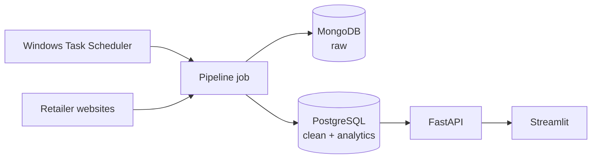

# finalPricing

End-to-end price intelligence for iPhones sold by Vietnamese retailers. The project tracks competitor prices, measures where the reference retailer (CellphoneS, set by `OWN_STORE`) sits in the market, and raises alerts when prices move.

> **Status:** the daily pipeline crawls CellphoneS, Hoang Ha Mobile and MobileCity, cleans and loads the prices, computes market positions and raises alerts. Price history from 8 September 2026 comes from the course's 8-store data. Forecasting is in progress.
>
> The reference retailer was FPT Shop until FPT started blocking crawlers (see [Data sources](#data-sources)). CellphoneS replaced it because it can be crawled every day and has the longest clean history.

## Architecture



All services share the `pricing_net` Docker network. Only the pipeline can reach MongoDB, and the dashboard reads data through the API, so it holds no database credentials.

| Service | Purpose | Local URL |
|---|---|---|
| `dashboard` | Streamlit dashboard | <http://localhost:8501> |
| `api` | FastAPI service, docs at `/docs` | <http://localhost:8000> |
| `postgres` | Clean and analytics tables | `localhost:${POSTGRES_PORT}` |
| `mongo` | Raw crawl documents | `localhost:${MONGO_PORT}` |
| `pipeline` | One-shot daily job (`jobs` profile) | n/a |

Ports bind to `127.0.0.1` only.

## Quick start

Full setup, scheduling and troubleshooting are in [DEPLOYMENT.md](DEPLOYMENT.md).

Requirements: Docker Desktop and [uv](https://docs.astral.sh/uv/).

```powershell
Copy-Item .env.example .env   # then replace each change_me value
docker compose up -d --build --wait
```

If a port is already in use on your machine, change it in `.env`.

Run the pipeline once:

```powershell
docker compose --profile jobs run --rm pipeline
```

`docker compose down` stops the stack and keeps the data. Adding `-v` deletes both database volumes.

## Pipeline

`src/pipeline/run_all.py` runs these stages in order and records each run in `pipeline_runs`. A failing stage stops the run, so later stages never build on incomplete data. Every stage can be re-run on the same day without creating duplicates.

| Stage | What it does | Writes |
|---|---|---|
| `crawl` | Fetches the iPhone listings of each store. One store failing does not stop the others. | `data/raw/<date>/products.jsonl`, MongoDB `raw_products` |
| `clean_load` | Parses prices, keeps new VN/A iPhones from the 15 series on, builds `product_match_key` (model + capacity), keeps the lowest price per store product | `iphone_clean_products`, rejected rows with a reason in `iphone_quarantine` |
| `analytics` | Market min, max, average and median per product and day, the gap to the median, a price index and one of six positions | `iphone_price_analytics` |
| `alerts` | Price changes of 2% or more since the last crawl, and competitors that became cheaper than the reference store | `price_alerts` |

Price changes need two crawl days, so the first run raises no alerts.

## Data sources

| Store | Method | Notes |
|---|---|---|
| CellphoneS | iPhone category page and one page per series | |
| Hoang Ha Mobile | Paged iPhone category | One card per model at its default capacity |
| MobileCity | Category, "Xem them" pages, then the variant list on each product page | One record per capacity, lowest price across colors |
| FPT Shop | Not crawled | Every request, including `robots.txt`, gets a Cloudflare bot challenge. The crawler does not try to get around it. |
| Course data (8 stores) | `src/pipeline/seed.py`, run once | 19,410 records from 8 September to 30 October 2026, loaded with `data_origin = 'teacher_seed'` |

The course data is not in this repository. Download the 8 JSON files from the course's MongoDB link into `data/seed/teacher/`, which git ignores, then run:

```powershell
docker compose --profile jobs run --rm pipeline python -m src.pipeline.seed
```

It goes through the same cleaning rules as the daily crawl. About half the records are quarantined, mostly prices above 120 million VND, which are crawl errors that cannot be repaired. Market positions and alerts are rebuilt for every loaded day, so alerts before 9 November are a replay of the history, not alerts raised at the time.

Crawlers read `robots.txt`, wait at least 1.5 seconds between requests and stop when a site answers with a bot challenge.

## Local development

uv manages Python 3.12 and the virtual environment from `pyproject.toml` and `uv.lock`.

```powershell
uv sync
uv run pytest
```

Add a dependency with `uv add <package>`, then refresh the pinned export:

```powershell
uv export --no-dev --no-hashes --no-emit-project -o requirements.txt
```

If the repository lives in a OneDrive folder, keep the environment outside it, because OneDrive rejects the hardlinks uv creates:

```powershell
$venv = "$env:LOCALAPPDATA\finalPricing\.venv"
New-Item -ItemType Directory -Force $venv | Out-Null
New-Item -ItemType Junction -Path .venv -Target $venv | Out-Null
```

## API

| Endpoint | Returns |
|---|---|
| `GET /health` | API and database status |
| `GET /api/v1/kpis` | Headline numbers for a store |
| `GET /api/v1/products` | Latest price per product |
| `GET /api/v1/products/{match_key}/history` | Daily price history |
| `GET /api/v1/alerts` | Price alerts, most severe first |
| `GET /api/v1/forecasts/{match_key}` | Stored forecasts |
| `POST /api/v1/assistant` | Answer to a price question |
| `GET /api/v1/pipeline/runs` | Recent pipeline runs |

## Dashboard

The dashboard has four tabs and refreshes every `DASHBOARD_REFRESH_SECONDS`:

- **Market:** headline cards, a chart of where the reference store sits against the market median, and a price table by store with the lowest price highlighted.
- **Price history:** daily prices per store for one product, with the stored forecast as a dashed line and range.
- **Alerts:** price alerts as cards, filtered by severity.
- **Assistant:** chat with example questions.

## AI Assistant

The dashboard's assistant answers price questions in English or Vietnamese. Both engines use the same read-only queries in `src/api/queries.py`.

- **LLM router (optional).** If `OPENAI_TOKEN_API_KEY` is set, an OpenAI model (`OPENAI_MODEL`, default `gpt-5.4-mini`) chooses which queries to call: `latest_prices`, `price_history`, `price_changes`, `forecasts`, `alerts`, `market_position` and `catalog`. It then writes the answer in the question's language. It never writes SQL.
- **Number check.** Every number of 10,000 or more in an LLM answer must appear in the query results. If one does not, the model is asked to rewrite once; if it still fails, the rules answer is returned.
- **Rules** always work and are the fallback for any LLM error. Keywords pick one of four question types (cheapest store, comparison, forecast, alerts) and a fixed English template formats the answer.

The key is passed to the API container only.

## Scheduling

`scripts/run_daily.ps1` starts Docker if needed, brings the stack up and runs the pipeline. Register it once, from a normal PowerShell window:

```powershell
powershell -ExecutionPolicy Bypass -File scripts\register_task.ps1 -VietnamTime 07:00 -EndDate 2026-12-08
```

The job runs daily at 07:00 Vietnam time, converted to the machine's clock, until 8 December 2026. Re-run the script if the machine's time zone or daylight saving changes. A missed run starts as soon as the machine is available. Logs are written to `logs/`.

## Project layout

```text
.streamlit/  Dashboard theme (light and dark)
app/         Streamlit dashboard
config/      Settings read from the environment
data/        Local data, only data/sample is versioned
db/init/     PostgreSQL schema
docs/        Project documentation
notebooks/   Data quality, EDA and modelling
scripts/     Task Scheduler scripts
src/         API, crawlers, pipeline, alerts and models
tests/       Automated tests
```

## Data policy

- Secrets live in `.env`, which is never committed.
- Crawled data and data supplied by the course stay out of this repository.
- Crawlers respect `robots.txt` and bot challenges, collect public product data only, and run once a day with a delay between requests.
- This project is for learning purposes.
