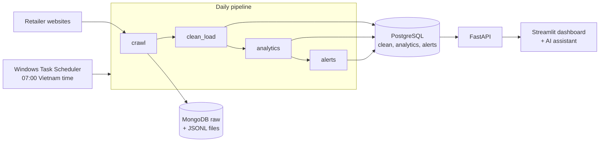
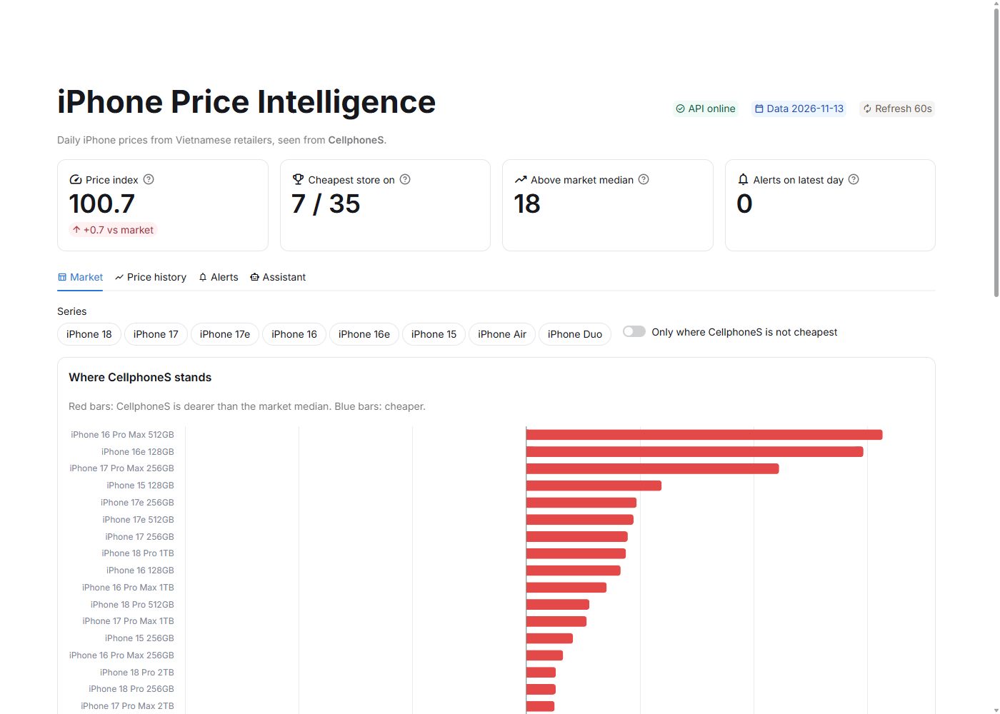
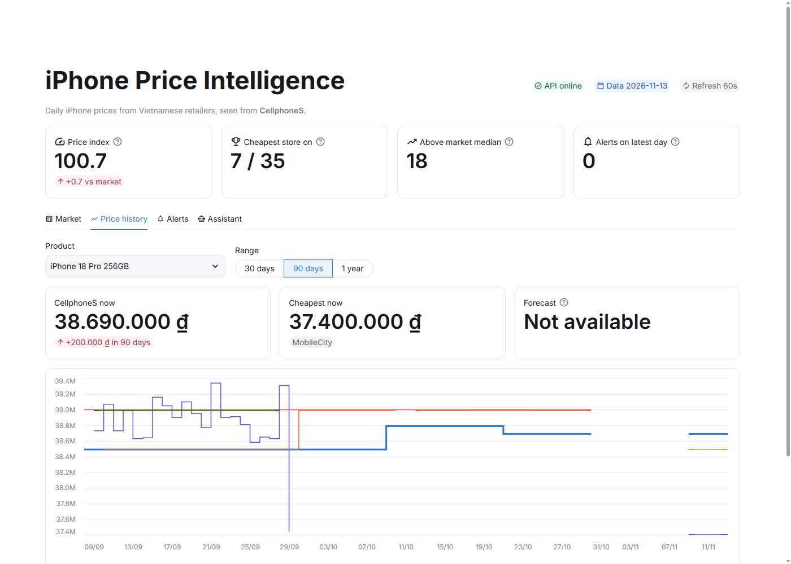
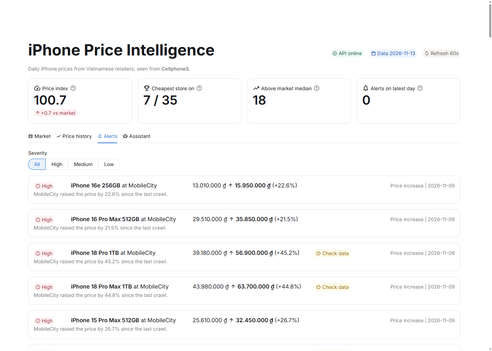

# iPhone Price Intelligence: Final Report

Data Science Bootcamp: Pricing Intelligence, final project.
Data as of **13 November 2026**. Every number in this report comes from the project database through the queries in [report_queries.sql](report_queries.sql) (Q1 to Q15).

> **Draft status.** The data pipeline, alerts, dashboard and AI assistant are finished and run every day. The price forecasting model (section 3.3) and the notebooks for data quality and EDA are still in progress, so section 3.3 describes the plan, not results.

## Summary

Vietnamese iPhone retailers change prices without notice. A pricing team that checks competitors by hand sees the change late and cannot tell how far it sits from the market. This project crawls three retailers every morning, cleans and matches their listings to the same iPhone model and capacity, and shows the reference retailer (CellphoneS) where it is cheaper or dearer than the market, with alerts when a competitor moves.

On 13 November 2026, CellphoneS had a **price index of 100.7**: on average 0.7% above the market median. It was the cheapest store for 7 of its 35 iPhones and the most expensive of the three stores for 18. Three models account for most of the gap: iPhone 16 Pro Max 512GB (+6.3%), iPhone 16e 128GB (+5.9%) and iPhone 17 Pro Max 256GB (+4.4%).

| | |
|---|---|
| Stores crawled daily | 3 (CellphoneS, Hoang Ha Mobile, MobileCity) |
| Historical data | 8 stores, 8 September to 30 October 2026 (course data) |
| Products tracked | 54 iPhone model and capacity combinations, 32 sold by all three stores |
| Clean rows | 10,239 (9,577 history + 662 from the daily crawl) |
| Pipeline runs | 12 runs, all successful, about 52 seconds each |
| Automated tests | 82 passing |

---

## 1. Business problem and data collection

### 1.1 Problem

**Business problem.** A retailer selling iPhones needs to know every morning whether its prices are competitive, which competitor just changed a price, and which products to re-price first.

**Data problem.** For every iPhone model and capacity, collect the selling price at each retailer once a day, match the same product across stores, and compute the reference store's position against the market. Flag significant price moves and data that looks wrong.

**Reference store.** The plan used FPT Shop. From 9 November, every request to fptshop.com.vn, including `robots.txt`, returned HTTP 403 with a Cloudflare bot challenge (`cf-mitigated: challenge`). The project does not work around bot protection, so CellphoneS replaced FPT Shop as the reference store. CellphoneS can be crawled every day and has the cleanest history (Q3). The reference store is a setting (`OWN_STORE`), not a code change.

**KPIs shown to the pricing team**

| KPI | Definition |
|---|---|
| Price index | Reference price / market median x 100, averaged over products sold by 2+ stores |
| Cheapest on | Products where the reference store has the lowest price |
| Above market median | Products where the reference store is above the median |
| Alerts | Price moves of 2% or more since the last crawl, and competitors that became cheaper than the reference store |

### 1.2 Scope

- **Products:** new, official Vietnamese (VN/A) iPhones from the iPhone 15 series on, including the e, Air and Duo models. Used, refurbished (CPO), display and grey-import phones are excluded.
- **Product key:** model + capacity, for example `iphone-17-pro-max-256gb`. Colors are merged and the lowest price is kept.
- **Frequency:** once a day at 07:00 Vietnam time, from 9 November to 8 December 2026.

### 1.3 Data sources

| Source | Method | Period | Records |
|---|---|---|---|
| CellphoneS | Category page plus one page per iPhone series | Daily from 9 Nov | 35 to 36 products a day |
| Hoang Ha Mobile | Paged iPhone category | Daily from 9 Nov | 43 products a day |
| MobileCity | Category, "load more" pages, then the variant list on each product page | Daily from 9 Nov | 54 products a day |
| FPT Shop | Not crawled (Cloudflare challenge) | | |
| Course data, 8 stores | MongoDB export provided by the course | 8 Sep to 30 Oct | 19,410 records |

All crawlers read `robots.txt`, wait at least 1.5 seconds between requests and stop if a site returns a bot challenge. The course data stays out of the public repository.

### 1.4 Architecture



Everything runs in Docker Compose on one network. Raw records are written to disk first and then to MongoDB, so a database failure never loses a crawl. The dashboard reads only through the API and holds no database credentials. Each run is logged to a file and to the `pipeline_runs` table.

---

## 2. Data cleaning and preparation

### 2.1 Data quality problems found

The course data had serious quality problems, which shaped the cleaning rules:

| Problem | Example | Rule |
|---|---|---|
| Prices far above any real iPhone price | Hoang Ha iPhone Air 256GB at 1,673,030,000 VND; TGDD iPhone 18 Pro Max at 4,849,000,000 VND | Quarantine prices outside 1 to 120 million VND. They cannot be repaired by dividing by 10 or 100. |
| Wrong prices below the 120 million cap | MobileCity iPhone 15 128GB at 115,190,000 VND (market about 21 million) | Quarantine prices below 0.65x or above 1.6x the product's cross-store median |
| Missing price ("Lien he") | 1,709 records | Quarantine |
| Two timestamp formats | ISO strings and `{"$date": ...}` objects | Parse both; the crawl day is the Vietnam calendar day |
| Capacity mixed with noise | "256 GB", "4-256gb", "(128GB, 256GB, 512GB)" | Parse the capacity field first, then the title |
| List price below selling price | Crawl error noted in session 4 | Drop the list price, keep the row |
| Used, CPO and grey-import phones | "iPhone 12 CPO Quoc te (Moi 100%)" | Quarantine as not new VN/A |

Rejected rows are never deleted. They go to `iphone_quarantine`, unchanged, with the reason, so the rules can be re-run.

### 2.2 Cleaning results

**Course data (Q2, Q3).** Of 19,410 records, 9,577 rows are clean, 8,697 are quarantined, and 1,136 duplicates (same store, product and day) were merged, keeping the lowest price.

| Reason | Rows |
|---|---:|
| Price outside 1 to 120 million VND | 6,327 |
| Missing price | 1,709 |
| Model before iPhone 15 | 463 |
| Not new VN/A | 94 |
| Price far from market | 57 |
| Unknown model or capacity | 47 |

Quarantine rates by store show where the source data is unreliable: TGDD 88.0%, MobileCity 78.9%, TopZone 72.1%, Hoang Ha 63.4%, Viettel Store 57.3%, FPT Shop 17.4%, CellphoneS 10.9%, Apple Store 0%.

**Daily crawl.** Over 5 days, 662 clean rows and 12 quarantined rows (7 models older than iPhone 15, 5 missing prices).

**Re-runs.** Every stage replaces the rows of the day it processes, so running the pipeline twice on the same day gives the same result. This was checked by running it twice and counting duplicates on `(store, product_id, crawl_date)`: zero.

### 2.3 Product matching

Each listing is mapped to a `product_match_key` (model + capacity) using shared parsing rules that handle Vietnamese text without accents and short forms such as "16 pm 256". Matching uses the key exactly; there is no fuzzy matching on the final key.

**Match rate on 13 November (Q4):** the share of a store's products that at least one other store also sells.

| Store | Products | Matched | Match rate |
|---|---:|---:|---:|
| CellphoneS | 35 | 35 | 100% |
| Hoang Ha Mobile | 43 | 43 | 100% |
| MobileCity | 54 | 42 | 77.8% |

MobileCity's 12 unmatched products are capacities the other two stores do not list, for example iPhone 15 512GB.

---

## 3. Analysis and machine learning

### 3.1 Features

Computed every day in `iphone_price_analytics` for each store and product:

- Market minimum, maximum, average and median across stores
- `price_diff`: gap to the cheapest store
- `price_diff_pct` and `price_index`: position against the market median
- `price_position`, one of six groups: only store, cheapest, below market, at market (within 1% of the median), above market, most expensive
- Discount: list price against selling price, where the store shows both

### 3.2 Exploratory findings

**Position by store (Q6, 13 Nov, products sold by 2+ stores)**

| Store | Products | Avg price index | Cheapest on | Most expensive on |
|---|---:|---:|---:|---:|
| Hoang Ha Mobile | 43 | 99.08 | 20 | 6 |
| MobileCity | 42 | 99.87 | 22 | 18 |
| CellphoneS | 35 | 100.71 | 7 | 18 |

**Price spread between stores (Q9, Q10).** Across the 44 products sold by at least two stores, the dearest store was on average **9.8% (2.93 million VND)** above the cheapest. The spread is largest on older or less popular models: iPhone 15 128GB 39.1% (15.45 million at MobileCity, 21.49 million at CellphoneS), iPhone Air 1TB 32.1%, iPhone 15 256GB 32.7%. The newest iPhone 18 Pro and Pro Max models stay within about 6%.

**How often prices change (Q11).** Share of consecutive days on which a store's price for a product changed:

| Store | Day pairs | Change rate | Average change |
|---|---:|---:|---:|
| Apple Store | 1,040 | 0.00% | |
| CellphoneS | 1,645 | 0.73% | 3.08% |
| Hoang Ha Mobile | 891 | 2.69% | 1.83% |
| FPT Shop | 909 | 3.19% | 5.37% |
| Viettel Store | 624 | 4.81% | 1.28% |
| TopZone | 247 | 8.91% | 1.07% |
| TGDD | 170 | 10.59% | 1.81% |
| MobileCity | 1,175 | 80.17% | 0.70% |

MobileCity's rate reflects noise in the course data (small daily movements of under 1% on most products, and capacities that appear to be mislabelled), not real repricing. Since the daily crawl started (10 to 13 November), only 4 prices changed across the three stores, the largest by 0.89%.

**Displayed discounts (Q12).** On its latest crawl day, CellphoneS showed a crossed-out list price on 25 of 35 products (average 7.8% off) and Hoang Ha on 24 of 43 (average 13.4% off). MobileCity shows no list price.

### 3.3 Price forecasting (in progress)

Not completed yet. The plan, and what the data already says about it:

- **Models:** a baseline that repeats yesterday's price (`lag_1`), a 7-day moving average, Linear Regression and Random Forest on lag and rolling features.
- **Evaluation:** walk-forward validation on the last 14 days, reporting MAE and MAPE for all days and separately for days when the price changed, against the course target of MAPE at or below 2.5%.
- **Output:** a 7-day forecast for each CellphoneS product, stored in `price_forecasts` and shown as a dashed line on the dashboard.
- **Expectation:** CellphoneS changed a price on only 0.73% of days (Q11), so the `lag_1` baseline will be very hard to beat on overall MAPE. If no model beats it, the baseline will be used and the report will say so.
- **Weekly model:** ARIMA against a naive forecast on the 110-week history of iPhone 16 128GB at Apple Store, provided by the course.

---

## 4. Dashboard and data product

The Streamlit dashboard (`http://localhost:8501`) refreshes every 60 seconds and has four tabs under a row of KPI cards.



- **Market:** where CellphoneS stands against the market median for each product (red bars dearer, blue cheaper), and a price table by store with the cheapest price highlighted. Filters by series and "only where CellphoneS is not cheapest".
- **Price history:** daily prices per store for one product over 30 days, 90 days or 1 year, with lines broken where days are missing so no price is invented.



- **Alerts:** cards with severity, old and new price, change and reason, filtered by severity. Moves of 40% or more are marked "Check data" instead of being reported as competitor moves.



- **Assistant:** answers questions in English or Vietnamese, such as "Which store is cheapest for iPhone 17 256GB?". Fixed rules always work. If an OpenAI key is set, an LLM chooses among seven read-only query functions; it never writes SQL, and every number in its answer must appear in the query results, otherwise the rules answer is returned.

**Alert rules**

| Type | Trigger | Severity |
|---|---|---|
| Price drop / increase | Change of 2% or more since the store's last crawl | High above 20%, medium from 10%, otherwise low |
| Undercut | A competitor is now cheaper than CellphoneS and was not on the last crawl | High above 20% cheaper, otherwise medium |
| Suspected data error | Any change of 40% or more | Flag on the alert |

**Alerts raised (Q14).** Replaying the rules over the course data gave 159 alerts (79 undercuts), 7 flagged as possible data errors. The first live day (9 November, compared with 30 October) raised 31. From 10 to 13 November there were no alerts, which matches the data: no price moved by 2% or more.

**Operations.** The pipeline runs from Windows Task Scheduler at 07:00 Vietnam time, starts Docker if needed, and catches up if the machine was off. All 12 runs so far succeeded (Q15), including the scheduled runs on 10, 11, 12 and 13 November.

---

## 5. Business insights and recommendations

### Insight 1: CellphoneS is the dearest of the three stores, but only on a few products by much

- **Phenomenon:** CellphoneS has the highest average price index (100.71, against 99.08 at Hoang Ha and 99.87 at MobileCity) and is the most expensive store on 18 of 35 products (Q6). On most of them the gap to the median is under 2% (Q7).
- **Cause (hypothesis):** CellphoneS keeps prices stable, changing them on 0.73% of days (Q11), while competitors adjust more often and sit just below it.
- **Implication:** three products drive the gap: iPhone 16 Pro Max 512GB at 38.99 million (2.30 million above the 36.69 million median), iPhone 16e 128GB at 14.29 million (0.80 million above 13.49 million) and iPhone 17 Pro Max 256GB at 34.99 million (1.49 million above 33.50 million).

### Insight 2: The big price gaps are on older models, not new launches

- **Phenomenon:** the average spread between the cheapest and dearest store is 9.8%, but iPhone 15 128GB differs by 39.1% and iPhone Air 1TB by 32.1%, while the iPhone 18 Pro family stays within about 6% (Q9).
- **Cause (hypothesis):** new models sell close to Apple's list price everywhere, while stores clear older stock at very different speeds.
- **Implication:** price competition happens on the previous generations. CellphoneS sells iPhone 15 128GB at 21.49 million against 15.45 million at MobileCity. It should either match on these models or present the difference (warranty, service) explicitly.

### Insight 3: Prices barely move day to day

- **Phenomenon:** in four days of live crawling, only 4 prices changed, by at most 0.89%. Apple Store never changed a price in 53 days (Q11).
- **Cause:** the market follows Apple's list prices and moves mainly around launches and promotions.
- **Implication:** daily monitoring is valuable for the rare moves, and alerts should be tuned to them. A daily price forecast will add little over "same as yesterday" (section 3.3).

### Insight 4: Hoang Ha advertises deeper discounts

- **Phenomenon:** Hoang Ha shows a crossed-out price on 24 of 43 products with an average 13.4% discount; CellphoneS on 25 of 35 with 7.8% (Q12).
- **Cause (hypothesis):** different list-price policies, since selling prices are close (index 99.08 against 100.71).
- **Implication:** customers comparing advertised discounts see Hoang Ha as cheaper by more than the real price difference.

### Recommendations for CellphoneS

1. **Re-price three products first:** iPhone 16 Pro Max 512GB, iPhone 16e 128GB and iPhone 17 Pro Max 256GB. Moving them to the market median costs 0.80 to 2.30 million VND per unit and removes most of the gap behind the 100.7 index.
2. **Decide a policy for previous-generation models**, starting with iPhone 15 and iPhone Air, where the gap to the cheapest store reaches 32 to 39%.
3. **Track the price index and the "cheapest on" count every morning** on the dashboard, and act on undercut alerts the same day.
4. **Review list-price display** against Hoang Ha's advertised discounts.

---

## 6. Results against the assessment criteria

| Criterion | Evidence | Status |
|---|---|---|
| Technical: pipeline runs, clear code, logs | `src/pipeline/run_all.py`, `logs/`, `pipeline_runs`, 82 tests | Done |
| Data quality | Quarantine table with reasons, rules in section 2, re-run check | Done; notebook in progress |
| Analysis: EDA with numbers | Section 3.2, `docs/report_queries.sql` | Partly done; EDA notebook in progress |
| Model: baseline and evaluation | Section 3.3 | In progress |
| Product: dashboard with alerts | Section 4 | Done |
| Presentation: clear, concrete recommendations | Section 5 | Done in this draft |
| Packaging: README, requirements, re-runnable | `README.md`, `DEPLOYMENT.md`, Dockerfile, `requirements.txt`, `uv.lock` | Done; clean-machine test pending |

---

## 7. Lessons learned

- **Source data cannot be trusted by default.** 45% of the course data had to be quarantined, and a fixed price range missed errors that were wrong by a factor of 5. A cross-store sanity check caught them, but only after it was changed to weigh each store once: Apple Store's one row per color had pulled the median towards its list price.
- **Sites change and block crawlers.** Hoang Ha redesigned its pages between the homework and the project, and FPT Shop moved behind a bot challenge. The pipeline survives a failing store, and the reference store is a setting.
- **Re-runs must be safe.** Each stage replaces the data of the day it processes. A bug where a re-run kept the previous run's alerts was found only by re-running on purpose.
- **Do not invent data.** Charts break lines across missing days, and alerts before 9 November are reported as a replay of the history, not as alerts raised at the time. The dashboard does not show this distinction yet.
- **If starting again:** check every target site for bot protection in the first week, and start daily crawling on day one, since history cannot be collected later.

## 8. Limitations and next steps

**Limitations**

- Only three stores are crawled daily; the other five have history up to 30 October only.
- There is a gap from 31 October to 8 November between the course data and the daily crawl.
- The course data for MobileCity is noisy (Q11), and some of its capacities appear mislabelled.
- Stock status is available for MobileCity only.
- The base iPhone 18 is sold only by MobileCity, with one starting price assigned to 256GB.

**Next steps**

- Price forecasting and the weekly ARIMA model (section 3.3).
- Data quality and EDA notebooks.
- Crawlers for TGDD, TopZone, Viettel Store and Apple Store, where their sites allow it.
- Alerts for changes in price position, and an estimate of alert precision from a labelled sample.
- A test run on a clean machine.

## 9. Conclusion

The project turns three retailers' websites into a daily, clean, matched view of the iPhone market, and tells CellphoneS each morning where it stands and what changed. Today it shows that CellphoneS is 0.7% above the market, driven by three products, and that the real price competition is on previous-generation models.

**Open question:** should a retailer follow the cheapest competitor on every model, or only where customers actually compare prices?

---

## Appendix: reproducing the numbers

```powershell
docker compose up -d --build --wait
docker compose --profile jobs run --rm pipeline python -m src.pipeline.seed   # course data, once
docker compose --profile jobs run --rm pipeline                               # daily pipeline
docker compose exec -T postgres sh -c 'psql -U "$POSTGRES_USER" -d "$POSTGRES_DB"' < docs/report_queries.sql
```

The course data must first be downloaded into `data/seed/teacher/` (see the README). The queries take the report date as a parameter at the top of the file.
